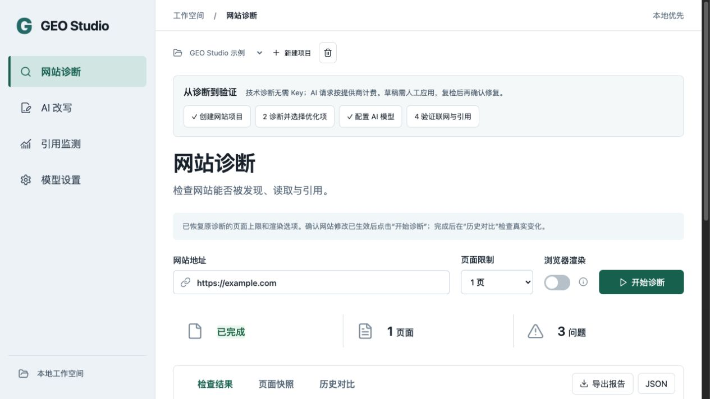
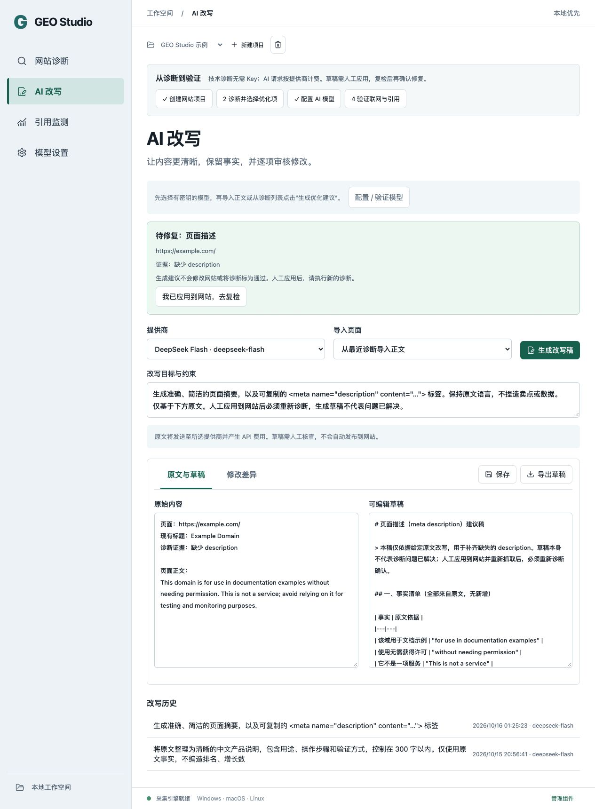
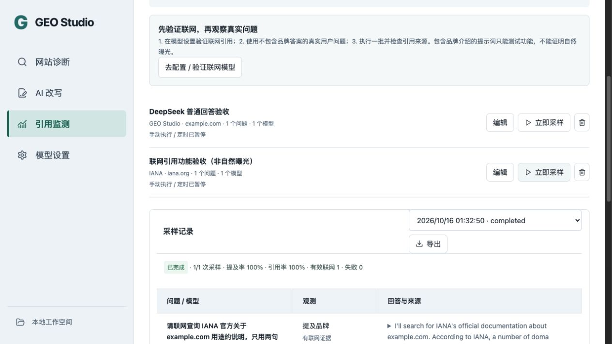
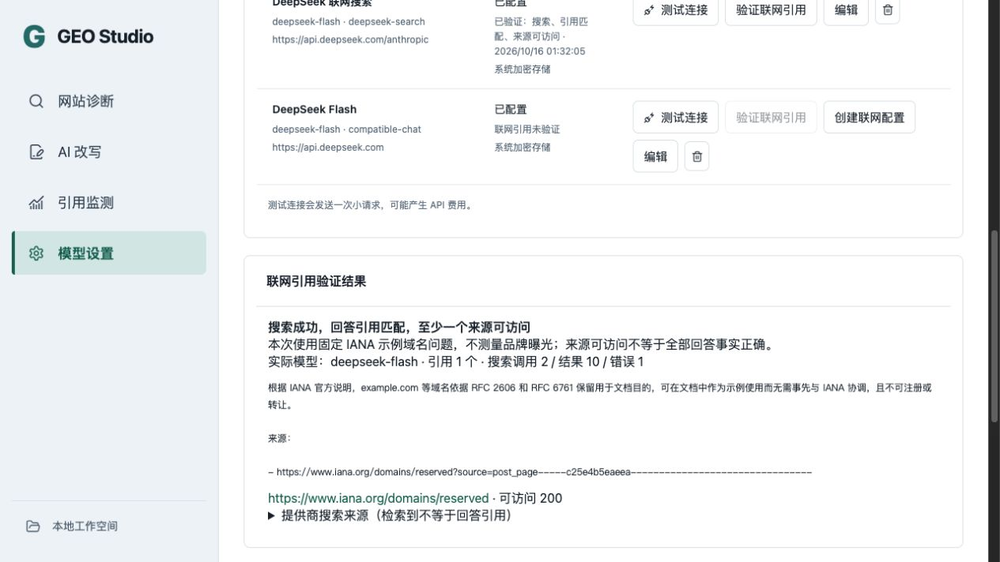

# GEO Studio

[English](README.md) · [简体中文](README.zh-CN.md)

面向 Windows、macOS 和 Linux 的本地 GEO 工作台：采集网站、查看证据、改写内容、修改后复检，并使用自己的 API 观察 AI 回答。

当前界面为简体中文，通过 GitHub 提供源码和自行构建教程；签名、公证不作为项目交付要求。工具仍处于早期阶段，本地桌面运行验收在 macOS x64 完成，其他系统仍需实机交互验收。

[本地部署](#本地部署) · [API 配置](#配置自己的-api) · [桌面打包](#自行打包桌面应用) · [常见问题](#常见问题)



## 功能

- **使用引导**：四步操作提示、提供商预设、DeepSeek 本机密钥复用，以及独立联网引用验证入口。
- **网站诊断**：组合 SiteOne 采集、可选 Chromium 渲染及 Protego robots 解析，检查 HTTP、noindex、摘要限制、标题、描述、canonical、H1、正文、JSON-LD 语法等。
- **证据与复检**：查看页面快照和原始证据，对比最近两次完成的诊断；缺失或未知结果不会算作问题已解决。
- **AI 改写**：导入已采集正文或粘贴文本，配置目标，生成草稿、查看差异、人工编辑、保存并导出 Markdown。标题、描述、H1、正文和 JSON-LD 失败项可直接创建携带原始证据的优化任务；生成草稿不会将问题标记为已解决。
- **回答与引用监测**：固定问题集、品牌别名、目标域、多提供商、重复采样，保留回答、来源字段和历史指标。
- **本地定时**：手动、每小时或每天执行，单批最多 30 次请求；仅在应用运行期间生效。
- **导出**：Markdown、JSON，不包含 API Key。







## 如何理解指标

提及率以成功返回文本的样本为分母。引用率只以具有提供商联网证据的成功样本为分母。普通 Chat 回答自行生成的链接单独展示，不会变成已验证引用；没有有效联网样本时，引用率显示为不可计算。

API 观测不等于同品牌消费端 App 的表现。技术检查和内容改进不保证收录、引用、排名或业务增长。生成的内容不会自动发布到网站。

## 本地部署

### 1. 准备环境

| 系统 | 现有组件支持的架构 | 终端 |
| --- | --- | --- |
| Windows | x64 | PowerShell |
| macOS | Intel x64 / Apple Silicon arm64 | 终端（zsh/bash） |
| Linux | x64 | bash 等终端 |

安装 Git、Node.js 24（包含 npm）、Python 3.12 和 `tar`，确保命令已加入 `PATH`。这些版本与构建工作流一致。组件脚本在 Windows 使用 `python`，在 macOS/Linux 使用 `python3`；部分 Linux 发行版还需安装对应的 Python venv 包。暂不提供 Windows/Linux arm64 组件。

需要渲染对照时，再安装 Chromium 或 Google Chrome。无需数据库服务器或云端部署。网站诊断无需 API Key；AI 改写和回答监测需要自己的供应商账号及 API 额度。

### 2. 获取源码并准备组件

Windows 在 PowerShell、macOS/Linux 在终端执行：

```sh
git clone https://github.com/MkaliezZ/geo-studio.git
cd geo-studio
npm ci
npm run components -- --release
```

此过程需要访问 npm、PyPI 和 GitHub Release 下载地址。组件命令下载固定版本的 SiteOne 并校验 SHA256，在项目本地虚拟环境中构建 Protego 辅助程序；这条安装路线无需全局安装 Python 包，也无需安装 `uv`。请在目标运行系统和架构上构建。

### 3. 启动并完成首次操作

```sh
npm run dev
```

此命令启动 Electron 桌面应用和仅限本机访问的开发预览。使用时保留终端，退出应用或在该终端按 Ctrl+C 停止服务。开发预览用于本机开发，不作为公网多人 Web 部署方案。

1. 创建项目，填写公开网站 URL，先执行单页诊断。
2. 打开失败项查看证据；支持的内容问题可直接创建优化任务。
3. 在「模型设置」配置 API，生成并审阅草稿，再手动把选定修改应用到网站。
4. 使用相同范围复检网站，对比前后结果；仅保存草稿不会消除诊断问题。
5. 配置监测问题、品牌别名和目标域；使用支持搜索的协议，先通过「验证联网引用」确认联网证据，再解读引用指标。

桌面数据位于 Electron 的用户数据目录。浏览器预览默认使用 `.data/`，预览密钥仅在本次会话有效。需要脱离开发终端运行时，按下文打包桌面应用。

## 配置自己的 API

在「模型设置」填写名称、协议、Base URL、模型 ID 和自己的 API Key。「测试连接」会发送一次小请求，可能产生 API 费用。

| 协议 | 用途 |
| --- | --- |
| OpenAI Responses | 改写；监测要求端点支持 `web_search` |
| Perplexity Agent API | 改写、带提供商搜索来源的监测 |
| DeepSeek 联网（Anthropic 兼容） | 真实联网回答、搜索结果与回答引用匹配 |
| OpenAI-compatible Chat | 改写、普通回答与品牌提及监测 |

DeepSeek 选择 **OpenAI-compatible Chat**，Base URL 填写 `https://api.deepseek.com`，模型使用账号支持的 ID，例如 `deepseek-flash`。已执行真实连接、中文改写和普通回答监测测试；需要联网监测时，选择 **DeepSeek 联网搜索** 预设（`https://api.deepseek.com/anthropic`），或在已有的 DeepSeek 官方配置上点击「创建联网配置」，然后执行「验证联网引用」。Chat 和 Responses 通道不能代替这条搜索通道；API 验收仍不代表消费端 App 表现。模型及价格可能变化，请核对[官方文档](https://api-docs.deepseek.com/zh-cn/)。

联网验证通过需要：提供商成功搜索、回答引用与检索来源匹配，以及至少一个来源页面本机可访问。匹配仅忽略已知追踪参数和 fragment，保留影响内容的查询参数。此检查验证证据链，不保证回答的所有事实正确。界面展示工具错误和实际搜索次数；一次采样可能产生多次搜索费用。

## 自行打包桌面应用

先完成本地部署的环境和组件准备，再执行检查：

```sh
npm test
npm run build
```

**macOS/Linux** 生成未签名应用目录：

```sh
CSC_IDENTITY_AUTO_DISCOVERY=false npm run package:dir
```

**Windows PowerShell**：

```powershell
$env:CSC_IDENTITY_AUTO_DISCOVERY = "false"
npm run package:dir
```

从 `release/` 下对应系统的解包目录启动应用：macOS 为 `.app`，Windows 为 `.exe`，Linux 为可执行程序。这样运行不依赖开发服务器，目标机器也无需安装 Node 或 Python。复制使用时应保留整个解包应用目录。

如需安装包或归档，把上述未签名命令中的 `npm run package:dir` 换成 `npm run package`：macOS 生成 DMG/ZIP，Windows 生成 NSIS 安装包，Linux 生成 AppImage。不需要签名账号或付费证书；未签名下载可能触发系统的发布者提示。请在目标平台打包，上述命令不提供任意跨系统交叉编译。

[GitHub Actions 工作流](.github/workflows/build.yml) 在 Windows、macOS、Linux 上构建和测试，并关闭签名自动发现。如果成功运行仍保留构建产物，登录 GitHub 后可在 [Actions](https://github.com/MkaliezZ/geo-studio/actions) 中下载，作为可选的未签名开发版本；项目主要分发方式仍是上述源码部署。

自动测试覆盖真实采集/robots、Chromium 生成的中文正文、复检、取消任务、密钥恢复、并发请求和提供商协议。测试使用受控接口，无需密钥，也不会调用付费 API。真实供应商与系统验收边界见[实现状态](docs/IMPLEMENTATION.md)。

## 更新已有部署

先保存本地源码修改，然后在仓库目录执行：

```sh
git pull --ff-only
npm ci
npm run components -- --release
npm run dev
```

独立桌面版本应先退出旧应用，再按未签名打包步骤重建，无需执行 `npm run dev`。保留用户数据目录；更新源码无需删除已有项目或 API 设置。

## 常见问题

| 问题 | 处理方式 |
| --- | --- |
| 找不到 Git、Node、npm、Python 或 `tar` | 安装依赖后重新打开终端；确认 Node 为 24，`python`（Windows）或 `python3`（macOS/Linux）指向 Python 3.12。 |
| 提示组件缺失、诊断无法启动 | 在当前机器执行 `npm run components -- --release`；组件二进制不随 Git 源码提交。 |
| 下载或 pip 安装失败 | 检查 npm、PyPI、GitHub Release 的网络连通性；Linux 确认已安装 Python venv 支持，再重试失败步骤。 |
| 无法进行渲染对照 | 安装 Chromium/Chrome，并在设置中填写浏览器可执行文件路径。 |
| 连接被拒绝、桌面界面未加载 | 使用 `npm run dev`，或启动已打包应用；单独执行 `npm start` 仍需要开发服务器。检查本机 5173/4319 端口是否被占用。 |
| API 测试或改写失败 | 检查 Base URL、协议、模型权限、余额和密钥；普通 Chat 配置不能直接提供已验证联网引用。 |
| 没有已验证引用 | 分别检查搜索结果、引用匹配和来源访问；工具错误或来源访问限制都可能导致验证不通过。 |

## 数据与隐私

密钥只存放在本机。桌面版优先使用操作系统加密；安全存储不可用时只保留在会话内；Linux 的 `basic_text` 后端不会用于持久化密钥。密钥与项目状态分开保存，不回传界面，也不进入报告导出。

诊断会访问目标网站。AI 操作会把所选正文或问题发送给配置的提供商并可能产生费用。应用关闭后不继续执行定时监测。

不要提交用户数据目录、`.data/`、`.env`、密钥、私人采集结果、日志或个人截图。上面的界面截图只使用公开示例内容。参见[安全说明](SECURITY.md)。

## 文档与许可证

- [PRD](docs/PRD.md)
- [实现与验收状态](docs/IMPLEMENTATION.md)
- [界面设计基线](docs/design/SYSTEM.md)

应用源码采用 [MIT](LICENSE)。第三方组件保留各自许可证，包括 SiteOne（MIT）和 Protego（BSD-3-Clause），许可声明位于 [resources/licenses](resources/licenses)。这些声明不构成完整法律认证。
